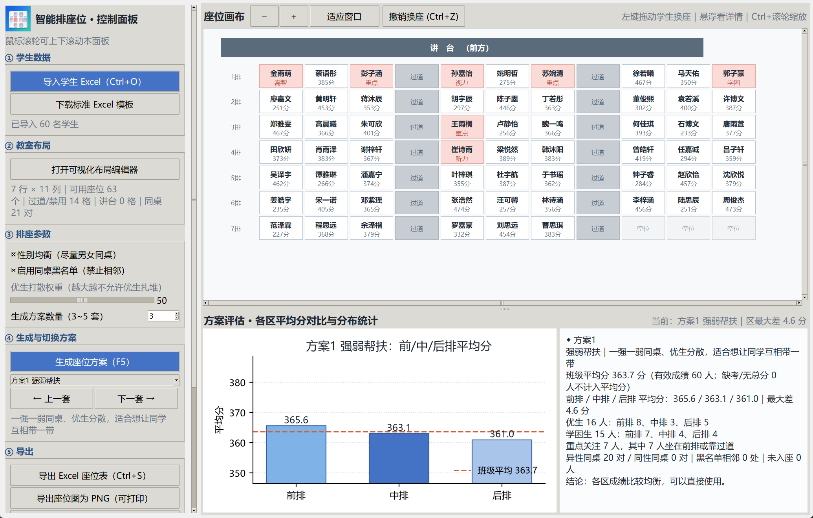
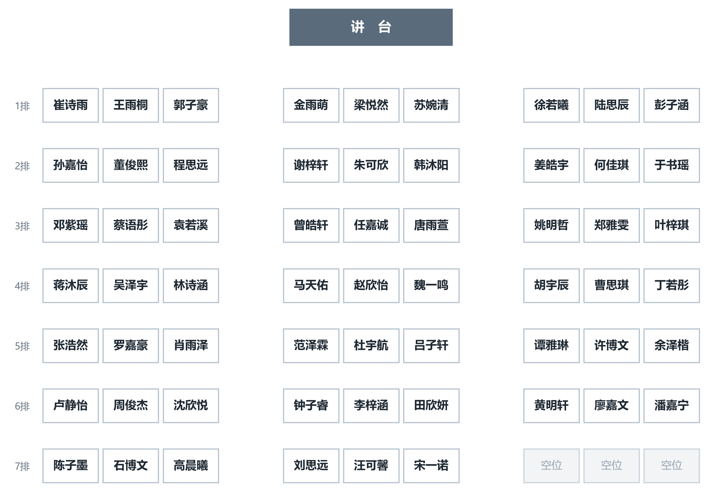
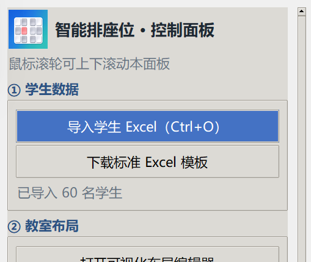

<div align="center">


# 智能学生排座位系统

**一个简单的桌面排座工具  一键生成 3~5 套座位排布方案**


作者：**北离Beilies**

---

导入一份成绩表，程序会自动容错、按教室布局生成 3~5 套差异化座位方案，
支持拖拽换座 / 撤销、前中后排成绩均衡评估，并导出 Excel 座位表、可打印的 PNG 座位图和统计报表。
**隐私保护：所有数据只留在本机**不需要浏览器、服务器、账号、联网，也不会上传任何学生信息。

> 请直接看「[免安装版使用](#-给老师三步就能用)」；代码请从「[开发者快速开始](#-开发者快速开始)」入手。

---

## ✨ 功能特性

| 能力 | 说明 |
|---|---|
| Excel 容错导入 | `.xlsx` / `.xls`、多 Sheet 选择、列名模糊匹配、表头不在第一行、合并单元格、空行、底部合计行、缺考 / `—` / `N/A` 全部自动处理；**缺考绝不按 0 分** |
| 可视化预览 | 导入后先弹预览表：告警分色、双击改单元格、增删行，确认后才进主界面；小屏幕下顶部与底部都有「确认导入」按钮 |
| 教室布局编辑器 | 左键设座位、右键设过道/禁用、拖动框选批量改，可保存 / 加载 JSON 模板；默认 **7 行 × 11 列、第 4/8 列过道、63 个座位**，打开即用 |
| 5 套差异化方案 | 强弱帮扶 / 同水平就近 / 均衡随机 / 性别优先 / 特殊学生优先；成本函数 + 随机交换优化，支持性别均衡、禁止同桌黑名单、优生打散权重 |
| 拖拽与撤销 | 左键拖动学生方格即可换座（可拖到空位），`Ctrl+Z` 悔棋；悬浮显示学号、总分、标签、禁止同桌对象、各科成绩 |
| 均衡评估 | 柱状图对比前 / 中 / 后排平均分，文字给出优生、学困生、重点关注学生分布与一句话结论 |
| 三种导出 | Excel 座位表（名单 + 彩色示意）、PNG 座位图、方案统计报表 |
| PNG 脱敏 | 只保留讲台、排号、姓名方格；**过道按原始位置留白**（不画过道方框、不写「过道」），**不显示重点关注标记**，无标题 / 图例 / 导出时间 |
| 友好降级 | 座位不够、黑名单无解、文件被占用等都用中文提示，不抛英文堆栈、不崩溃 |
| 免安装 exe | Windows 单文件 exe，双击即用，不需要 Python / pip / 联网 / 管理员权限 |
| 高 DPI 清晰显示 | 声明 Per-Monitor V2 DPI 感知，125% / 150% 缩放的笔记本不再被系统拉伸成模糊位图；界面字体、座位图 PNG（300 DPI）、评估柱状图同步提高渲染分辨率 |



<details>
<summary>查看导出的 PNG 座位图（默认 7×11 教室，第 4、8 列是留白过道）</summary>



</details>

---

## 🚀 给老师：三步就能用

1. 到本仓库的 **Releases** 页面下载最新版的 `智能排座位系统.zip`（或直接下载 `智能排座位系统.exe`）。
2. 解压到任意文件夹（桌面、D 盘都行，**别放进 `C:\Program Files`**），**双击 exe**。
3. 按左侧编号操作：`① 导入学生 Excel` → `④ 生成座位方案（F5）` → `⑤ 导出`。

> 第一次启动要解压内部组件，请等 5~20 秒。想先练手，可以导入 `examples/测试数据_60人成绩表.xlsx`
> （工作表选「标准名单」）；最简表格用 `examples/测试数据_60人_精简版.xlsx`，
> 没有「特殊标记」「禁止同桌名单」两列也完全能用。
>
> 详细图文教程：[docs/使用说明.md](docs/使用说明.md)；发给老师的一页纸：[docs/免安装版-先看我.txt](docs/免安装版-先看我.txt)。
>
> ⚠️ 仓库里**不含 exe**（约 49 MB），它只在 GitHub Releases 里发布，避免把二进制文件提交进 Git。

---

## 🛠 开发者快速开始

要求：Python **3.10+**（官方安装包，Windows 安装时勾选 `tcl/tk and IDLE`）。

```bash
git clone <你的仓库地址>
cd SmartSeatPlanner

# 1) 安装依赖
pip install -r requirements.txt

# 2) 启动（任选一种）
启动.bat                      # Windows 双击
python src/main.py            # 命令行，支持 --diagnose
python -m pytest -q tests     # 回归测试
python src/selfcheck.py       # 全链路自检（脏 Excel → 排座 → 三种导出）
```

`pip install -e ".[dev]"` 可以额外装上 pytest / PyInstaller / ruff，并得到 `smart-seat-planner` 命令。
Linux 需要系统包 `python3-tk`（Debian/Ubuntu：`sudo apt install python3-tk`）。

---

## 📁 目录结构

```
SmartSeatPlanner/
├── README.md                  ← 你正在看的这份
├── CHANGELOG.md               版本记录
├── LICENSE                    MIT 协议
├── pyproject.toml             项目元数据 / pytest / ruff 配置
├── requirements.txt           运行依赖
├── .gitignore / .gitattributes  忽略构建产物、固定换行与二进制资源
├── 启动.bat                    Windows 源码启动器（指向 src/main.py）
├── src/                       【全部 Python 源码】轻量 src 布局，模块平铺
│   ├── main.py                入口：依赖检查、中文报错、--diagnose、启动主窗口
│   ├── app_paths.py           统一源码 / exe 两种模式的路径与资源定位
│   ├── ui_scale.py            高 DPI 感知、界面缩放系数 px()、Tk 字体缩放
│   ├── models.py              Student、告警、配色、缺失值常量
│   ├── excel_io.py            Excel 解析 / 容错 / 预览表往返 / 标准模板
│   ├── layout.py              教室网格、同桌 / 相邻 / 分区 / JSON 模板
│   ├── seating.py             5 套策略 + 成本函数 + 优化（算法说明在文件头）
│   ├── evaluate.py            前中后排均分、分布统计
│   ├── exporter.py            Excel / 脱敏 PNG / 统计报表
│   ├── gui_main.py            主窗口 + 可拖拽座位画布
│   ├── gui_dialogs.py         导入预览、布局编辑器、评估面板、中文提示
│   └── selfcheck.py           无界面全链路自检
├── assets/                    图标与设计稿（app.ico / app_logo.png / 原图 / 预览）
├── examples/                  两份 60 人测试数据（含最简 4 列 / 2 列版）
├── docs/
│   ├── 使用说明.md             老师向完整教程（字段、六步、FAQ、打包）
│   ├── 开发文档.md             架构、数据流、算法、路径约定、扩展点
│   ├── 发布指南.md             打包 exe 与发布 GitHub Releases 的流程
│   ├── 免安装版-先看我.txt      发给老师的一页纸
│   ├── 完整代码汇总.txt         全部源码的单文件备份（自动生成）
│   └── screenshots/            README 截图
├── scripts/
│   ├── 打包exe.bat             一键 PyInstaller 打包 + 整理 release/
│   ├── 运行自检.bat            selfcheck + pytest
│   ├── 生成代码汇总.py         重新生成 docs/完整代码汇总.txt
│   └── 一键放到桌面.bat        给老师建桌面快捷方式（打包时会复制进 release/）
├── tests/test_pipeline.py     pytest 回归用例（布局 / 方案 / 空位 / 脱敏）
├── .github/workflows/ci.yml   GitHub Actions：语法、自检、回归测试
└── release/                   【本地构建产物】已 gitignore，exe 上传 Releases
```

运行时会自动在项目根目录（或 exe 同目录）创建 `教室模板/`、`自检输出/`、`运行日志.txt`，
这些都在 `.gitignore` 里，随时可删、程序会自己重建。

---

## 📖 六步使用流程

1. **导入**：`① 导入学生 Excel` → 选 Sheet → 预览窗口核对告警、双击改数据 → 点「确认导入 →」。
2. **画教室**（可选）：`② 打开可视化布局编辑器` → 左键座位 / 右键过道 / 拖动框选 → 可存 JSON 模板。
3. **调参数**：性别均衡、同桌黑名单、优生打散权重、生成 3~5 套。
4. **生成**：`④ 生成座位方案（F5）`。
5. **挑选与微调**：下拉框切换方案；左键拖动换座，`Ctrl+Z` 撤销；下方看均衡评估。
6. **导出**：Excel 座位表 / 脱敏 PNG 座位图 / 方案统计报表。

快捷键：`Ctrl+O` 导入、`F5` 生成、`Ctrl+S` 导出 Excel、`Ctrl+Z` 撤销、`Ctrl+滚轮` 缩放画布。
左侧控制面板较长，**鼠标放在左栏任意位置滚动滚轮**即可上下翻。

---

## 🧮 算法与评估（简述）

排座 = **5 套不同初始解 + 成本函数 + 随机交换优化**。成本项包含：前中后排均分差、优生相邻罚分、
同桌分差偏好、禁止同桌黑名单重罚、性别同座轻罚、重点关注学生靠前靠过道奖励。
学生少于座位时只启用「从前往后、从左到右」的前 N 个座位，**空位统一留在最后几排末尾**，不会夹在学生中间。

想加规则：在 `src/seating.py::_cost()` 增加一项，或在 `STRATEGIES` 里加一套权重配置即可。
完整说明见 [docs/开发文档.md](docs/开发文档.md) 与 `src/seating.py` 文件头长注释。

---

## 📦 打包与发布

```bash
# 开发自检
python src/selfcheck.py
python -m pytest -q tests

# Windows 一键打包（也可双击 scripts/打包exe.bat）
python -m PyInstaller --noconfirm --clean --onefile --windowed ^
  --name SmartSeatPlanner --icon "assets/app.ico" --distpath "release" ^
  --paths "src" --add-data "assets/app.ico;." --add-data "assets/app_logo.png;." ^
  --hidden-import selfcheck --hidden-import app_paths ^
  --hidden-import matplotlib.backends.backend_tkagg --hidden-import tkinter.ttk ^
  --collect-data matplotlib "src/main.py"
move /y "release\SmartSeatPlanner.exe" "release\智能排座位系统.exe"
release\智能排座位系统.exe --diagnose
```

`--diagnose` 会验证依赖、脏 Excel 全链路、主窗口创建、图标资源与若干 UI 回归项，
结果写到 exe 同目录的 `打包自检结果.txt`，结论「全部通过」才可发布。
发布到 GitHub Releases 的完整步骤见 [docs/发布指南.md](docs/发布指南.md)。

---

## 📚 文档索引

| 文档 | 适合谁 |
|---|---|
| [README.md](README.md) | 所有人：项目概览与快速开始 |
| [docs/使用说明.md](docs/使用说明.md) | 老师 / 使用者：字段、六步教程、FAQ |
| [docs/开发文档.md](docs/开发文档.md) | 开发者：架构、算法、路径、扩展点 |
| [docs/发布指南.md](docs/发布指南.md) | 维护者：打包、自检、发 Release |
| [docs/免安装版-先看我.txt](docs/免安装版-先看我.txt) | 发给老师的一页纸 |
| [CHANGELOG.md](CHANGELOG.md) | 版本变化 |

---

## ❓ 常见问题

**Q：双击 exe 没反应？** 第一次启动等 20 秒；右键属性看有没有「解除锁定」；被安全软件拦就选允许运行。
也可用 `智能排座位系统.exe --diagnose` 生成自检报告。

**Q：提示缺少 tkinter？** 装的是精简版 Python，换 python.org 官方安装包并勾选 `tcl/tk and IDLE`。

**Q：导入预览找不到「下一步」按钮？** 看窗口**右上角**蓝色的「下一步：确认导入 →」，或最下方同款按钮，也可以按 `Ctrl+回车`。

**Q：滚轮滑不动左侧面板？** 新版已修复（递归绑定了面板内所有控件 + 顶层兜底），把鼠标放在左栏任意位置滚动即可。

**Q：文字看起来发糊 / 分辨率不够？** 新版已声明 Windows DPI 感知，并按系统缩放重新设置字体、控件与图表尺寸（详见「高 DPI 清晰显示」）。如果仍想手动微调，可设置环境变量 `SEAT_UI_SCALE=1.25`（或 `1.5`）后重新启动；`exe --diagnose` 报告的【5】会列出当前 DPI 与缩放系数。

<details>
<summary>查看 150% 缩放下的 1:1 原像素文字细节</summary>



</details>

**Q：为什么仓库里没有 exe？** 单文件约 54 MB，二进制不适合进 Git；请到 Releases 下载，或自己运行 `scripts/打包exe.bat` 生成。

---

## 🤝 贡献

欢迎提 Issue / PR。提交前请跑 `python -m pytest -q tests` 与 `python src/selfcheck.py`；
代码请使用中文注释，界面文案保持面向老师的口语化表达，任何异常都要转成中文提示而不是英文堆栈。

## 📄 许可

[MIT](LICENSE) © 2026 北离Beilies。程序图标亦由作者设计，见 `assets/图标原图.jpg`。

---

<div align="center">如果这个项目帮到了你，欢迎给仓库点个 ⭐</div>
