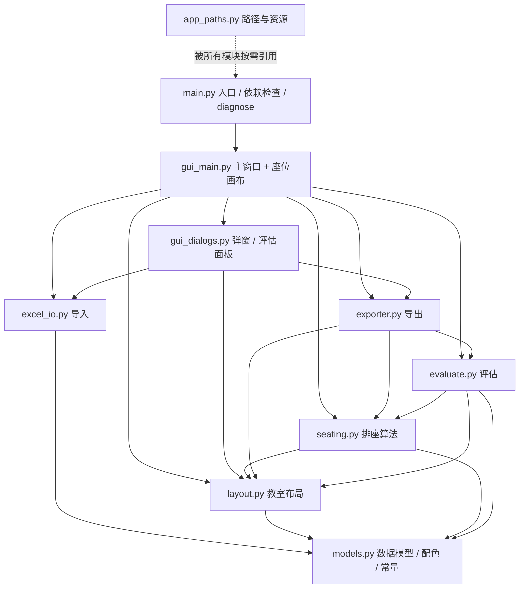

# 开发文档

> 面向想改代码 / 二次开发的人。老师使用请看 [使用说明.md](使用说明.md)，
> 打包发布请看 [发布指南.md](发布指南.md)。

---

## 1. 技术选型

| 项目 | 选择 | 原因 |
|---|---|---|
| 界面 | Python 自带 `tkinter` / `ttk` | 官方发行版自带，老师不用装浏览器或前端运行时 |
| Excel 读取 | `pandas` + `openpyxl` + `xlrd` | 同时支持 `.xlsx` 与老式 `.xls` |
| 图表 / 图片 | `matplotlib`（`Agg` 导出 PNG，`FigureCanvasTkAgg` 内嵌界面） | 不依赖额外 GUI 框架 |
| 图标 | `Pillow` 生成，`.ico` + `.png` 双份 | Windows 标题栏高 DPI 与 exe 图标 |
| 打包 | `PyInstaller --onefile --windowed` | 交付单个 exe，免安装 |
| 测试 | `pytest` + `selfcheck.py` | 纯业务层无需图形界面，可进 CI |

Python ≥ 3.10。运行依赖见根目录 `requirements.txt`，开发依赖见 `pyproject.toml` 的 `[dev]`。

---

## 2. 模块与依赖方向

采用 `src/` 平铺布局（本项目是桌面程序，模块之间用绝对导入，入口 `src/main.py`）。
依赖是**单向**的：改算法不会影响界面，改导出不会影响导入。



| 模块 | 职责 | 关键入口 |
|---|---|---|
| `models.py` | `Student`、告警类型、配色、缺失值常量；**不依赖任何业务模块** | `Student.is_focus()`、`MISSING_TOKENS` |
| `app_paths.py` | 源码 / exe 两种模式的 `BASE_DIR`、`asset_path()` | `_project_root()`、`asset_path()` |
| `excel_io.py` | 读表、表头扫描、模糊列名、容错、预览表往返、模板 | `import_excel()`、`students_from_table()` |
| `layout.py` | 网格、座位/过道/讲台、同桌与相邻、分区、JSON 模板 | `ClassroomLayout.seats()`、`desk_pairs()` |
| `seating.py` | 5 套策略、成本函数、随机交换优化、黑名单修复 | `generate_plans()`、`_cost()`、`_front_seats()` |
| `evaluate.py` | 分区均分、优生/学困/重点关注分布、柱状图数据 | `attach_stats()`、`evaluate_plan()` |
| `exporter.py` | Excel / PNG / 报表导出、中文字体选择 | `export_seating_excel()`、`build_seat_figure()` |
| `gui_main.py` | 主窗口、控制面板滚轮、座位画布拖拽/悬浮/缩放 | `MainWindow`、`SeatBoard` |
| `gui_dialogs.py` | 导入预览、Sheet 选择、布局编辑器、评估面板、中文提示 | `ImportPreviewDialog`、`safe_call` |
| `selfcheck.py` | 无界面全链路自检，也被 `main.py --diagnose` 调用 | `selfcheck.main()` |
| `main.py` | 依赖检查、中文报错、`--diagnose`、启动主窗口 | `main()`、`diagnose()` |

---

## 3. 数据流

```
Excel 文件
  → import_excel()                     # 扫描表头、展开合并单元格、容错、告警
  → ImportResult(students, warnings)
  → 预览窗口 ImportPreviewDialog       # 老师可双击改 / 删行 / 加行
  → students_from_table()              # 预览表 → Student 列表
  → generate_plans(students, layout)   # 5 套 Plan（assignment: Pos → Student）
  → attach_stats() / evaluate_plan()   # 前中后排均分与分布
  → GUI 画布渲染 / 拖拽换座 apply_swap()
  → exporter.*                         # Excel / PNG / 报表
```

**关键约定**

- `Student.score` 允许为 `None`（缺考 / `—` / `N/A` / 空白）。**任何地方都不得把 `None` 当 0 分**：
  总分缺失时用有效科目求和，全部缺失则按班级平均水平参与排座，统计时跳过。
- 座位坐标为 `(row, col)`，0 起算；`SEAT` / `BLOCK` / `PODIUM` 是格子类型常量。
- `Plan.assignment` 是字典，键是座位坐标，值是 `Student`；拖拽换座只改这个字典，不改学生对象。
- 所有用户可见异常都走 `gui_dialogs.show_error()` / `safe_call`，写 `运行日志.txt`，不弹英文堆栈。

---

## 4. 排座算法

`src/seating.py` 文件头有完整注释，这里只列框架：

1. **初始解**：`STRATEGIES` 定义 5 套权重/种子 → 强弱帮扶、同水平就近、均衡随机、性别优先、特殊学生优先。
2. **座位选择**：`_front_seats(seats, count)` 只取 `layout.seats()` 的前 N 个
   （从前往后、从左到右），空位统一留在最后几排末尾；优化器只在已入座座位之间交换，空位不会再散开。
3. **成本函数 `_cost()`**：

   | 成本项 | 含义 | 修改位置 |
   |---|---|---|
   | 分区均衡 | 前 / 中 / 后排标准化均分差异 | ① |
   | 优生打散 | 相邻优生罚分（界面滑块控制） | ② |
   | 强弱 / 同水平 | 同桌分差奖励或惩罚 | ③ |
   | 黑名单 | 相邻 / 同桌重罚 + `_repair_blacklist()` 强制修复 | ④⑤ |
   | 性别均衡 | 同桌同性别轻罚 | ⑤ |
   | 特殊学生位置 | 越靠前、越靠过道成本越低 | ⑥ |

4. **优化**：随机交换 + 模拟退火式接受准则；无解时保留方案并输出降级提示，不抛异常。
5. **冲突处理**：座位不够 → 未入座名单 + 建议扩大行列；黑名单过密 → 列出冲突名单，建议手动拖拽。

**加新规则**：在 `_cost()` 里加一项，或在 `STRATEGIES` 里加一套权重配置。
预留扩展（仅注释）：定时座位轮换、小组就近约束。

---

## 5. 路径与资源约定（`app_paths.py`）

| 运行方式 | `BASE_DIR` | 资源位置 |
|---|---|---|
| 源码（`python src/main.py`） | 项目根目录（`src/` 上一级，含 `pyproject.toml`） | `assets/` |
| PyInstaller 单文件 exe | exe 所在目录 | `sys._MEIPASS`（`--add-data` 打进去） |

`教室模板/`、`自检输出/`、`运行日志.txt`、`打包自检结果.txt` 都写在 `BASE_DIR`，
不会被写进 PyInstaller 退出即删除的临时目录。若 exe 放在只读位置（如 `C:\Program Files`），
自动退回 `~/Documents/SmartSeatPlanner`。

> 图标读取统一走 `asset_path("app.ico")` / `asset_path("app_logo.png")`，
> 源码方式会依次找 `assets/` → `src/` → 项目根；资源缺失时静默降级，绝不让程序打不开。

---

## 6. 界面交互约定

| 操作 | 行为 |
|---|---|
| 左键拖动方格 | 交换座位（可拖到空位） |
| `Ctrl+Z` / 撤销按钮 | 撤销上一步换座 |
| 悬浮方格 | 显示学号、总分、标签、禁止同桌对象、各科成绩 |
| `Ctrl+滚轮` / `+ − 适应窗口` | 缩放座位画布 |
| 滚轮（左侧面板任意位置） | 上下滚动控制面板 |
| 布局编辑器左键 / 右键 / 拖动 | 设座位 / 设过道禁用 / 框选批量修改 |

**滚轮实现要点**（`gui_main.py::_bind_panel_wheel`）：Tk 把滚轮事件投递给鼠标下方的控件，
只给 Canvas 绑定是收不到的（Canvas 不在子控件的 bindtags 链条里）。
因此递归给面板所有子控件绑定，再在主窗口层做一次带位置判断的兜底；
另外 Windows 的 `<MouseWheel>` 事件 `event.num` 是字符串 `"??"`，**不能 `int()`**，
否则会抛异常被 Tk 静默吞掉，表现为「滚轮完全没反应」。

弹窗统一用 `fit_dialog()` 按屏幕自适应；按钮区先 `pack(side=BOTTOM)`、主按钮最先 pack，
保证高 DPI / 小屏幕上「确认导入」不会被裁掉。

---

## 7. 导出与隐私

| 产物 | 内容 | 是否有教师内部信息 |
|---|---|---|
| Excel 座位表 | 名单 Sheet + 彩色座位示意图 Sheet | 有（浅红标记、过道） |
| 方案统计报表 | 多方案对比、分区分布、冲突提示 | 有 |
| **PNG 座位图** | 讲台、排号、姓名 / 空位方格 | **无**：过道列整列删除、不画过道方框、不写「过道」，所有学生格白色，无重点关注文字与浅红底色，无标题 / 图例 / 导出时间 |

`build_seat_figure(plan, layout)` 同时被导出和回归测试使用，改 PNG 样式时只要改这一处。
回归断言在 `selfcheck.py` 与 `tests/test_pipeline.py`：文字数、patch 数、禁用词、浅红底色全部检查。

---

## 8. 验证方式

```bash
python -m compileall -q src        # 语法
python src/selfcheck.py            # 全链路：脏 Excel → 5 套方案 → 三种导出 + 回归断言
python -m pytest -q tests          # pytest 回归用例
python src/main.py --diagnose      # 额外真实创建主窗口、检查图标与 UI 回归项
release\智能排座位系统.exe --diagnose   # 打包后的完整性自检
```

`main.py --diagnose` 会输出 `打包自检结果.txt`，其中包含：依赖、全链路自检、
默认布局、窗口标题、左侧面板滚轮、导入预览按钮可见性、图标资源等检查项。
CI（`.github/workflows/ci.yml`）在 Python 3.10 / 3.12 上跑语法检查、自检和 pytest。

---

## 9. 代码规范

- 全部注释与界面文案使用中文；异常提示面向老师，避免英文堆栈。
- 业务模块不 import `tkinter`，保证 `selfcheck` / pytest 可在无图形环境运行。
- 导出与绘图统一 `matplotlib.use("Agg")`，中文字体由 `setup_chinese_font()` 自动降级选择。
- 所有按钮回调套 `@safe_call`；Tk 的 `report_callback_exception` 统一接管。
- 改完源码后运行 `python scripts/生成代码汇总.py` 更新 `docs/完整代码汇总.txt`。
- Windows 批处理（根目录 `启动.bat`、`scripts/*.bat`）用 **GBK + CRLF** 保存：
  中文版 `cmd.exe` 默认代码页 936，若改成 UTF-8 且加 `chcp 65001`，
  cmd 会按字节偏移误读后续中文行，把 `echo` 的中文当成命令报「不是内部或外部命令」。
  自动化执行可传 `--no-pause` 跳过结尾暂停（如 `scripts\打包exe.bat --no-pause`）。
